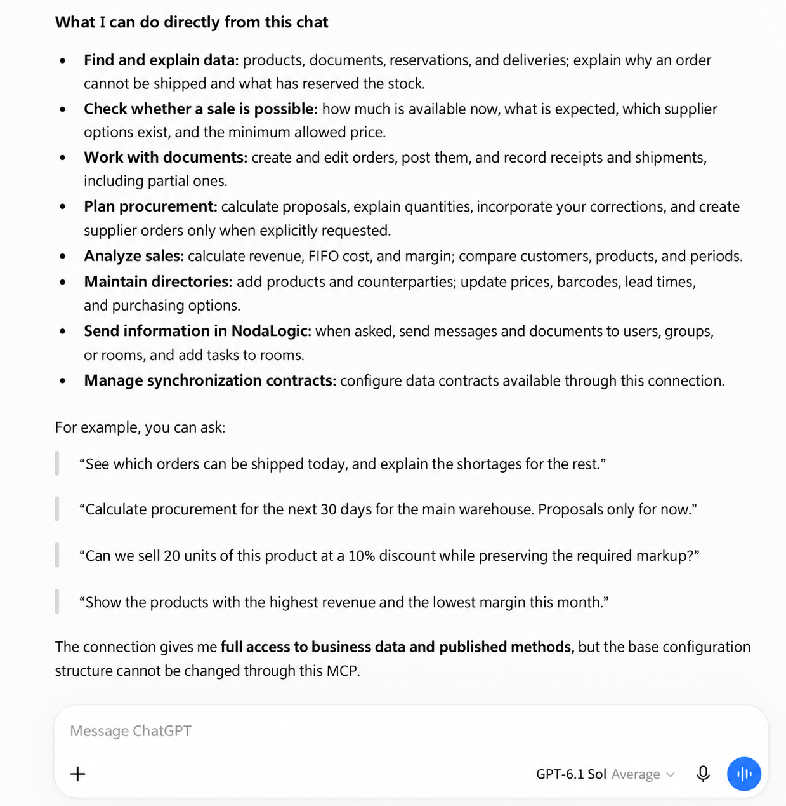

Data-level MCP server
=====================

A data-level MCP server gives an external AI client controlled access to one
deployed NodaLogic configuration. From a chat, the client can read and analyze
business data, create and update nodes, call published methods, and run business
operations exposed by the configuration.

NodaLogic solutions are built from nodes. A node combines data, class metadata,
and business behavior, so the connected model works with the solution's domain
model rather than with isolated tables. Semantic descriptions, nGenie prompts,
classes, indexes, and published methods help the model understand the data and
the operations that are allowed.

You can create several MCP links for one configuration and give each link a
different name and permission set—for example, separate connections for
analytics, sales, and administration.

.. important::

   An MCP link may allow data to be changed or deleted. Grant the minimum
   permissions required, connect only a trusted AI client, and revoke links that
   are no longer needed.

Access modes
------------

``Full access``
   The connection acts with the configuration owner's permissions. It can use
   all visible classes and nodes, call published methods, read QuantLedger
   directly, and manage contracts.

``As user``
   The connection acts as the selected user. Roles and row-level security (RLS)
   are evaluated on every request, so later permission changes take effect
   automatically.

``Allow user extensions``
   This optional setting lets the AI client create ordinary user extension
   sections, classes, and nodes in the extension workspace. It does not make
   the base configuration schema or handlers writable.

Capabilities
------------

The exact set of available actions depends on the user's permissions and on the
design of the connected configuration. In general, the MCP server lets an AI
agent:

* **Understand the configuration and its business logic.** The agent can inspect
  the solution purpose, available sections and classes, data structures,
  indexes, nGenie descriptions, and published business operations.
* **Read and search data.** It can retrieve individual nodes and lists, apply
  exact field filters, use declared indexes, and perform text searches. Every
  result remains subject to the user's permissions and RLS.
* **Read QuantLedger data.** With full access, the agent can discover accounting
  spaces, retrieve exact or grouped balances and movements, and calculate
  opening balances, receipts, issues, and closing balances for a period. These
  tools are read-only and strictly scoped to the connected configuration. They
  are not exposed in ``As user`` mode because QuantLedger rows do not carry node
  RLS rules.
* **Create, update, and delete nodes.** Changes pass through the normal
  NodaLogic runtime and the configuration's server handlers instead of writing
  directly to the database outside business logic.
* **Run business operations.** The agent can invoke published operations on an
  object or class—for example validation, calculation, document posting,
  reservation, or creation of a related document—when the configuration
  provides that operation.
* **Analyze data with nGenie.** The agent can use the configuration's prompts,
  skills, indexes, and domain descriptions, request clarification, prepare
  calculations, and perform actions when explicitly instructed.
* **Work with NodaLogic messaging.** It can discover users and groups, read
  accessible group history, create groups, manage members, send messages, and
  deliver real node documents.
* **Work with Rooms.** The agent can inspect accessible Rooms, devices, and
  object queues, deliver nodes to Rooms, and add or process Room tasks.
  Creating, updating, or deleting Rooms requires separate management rights.
* **Manage synchronization contracts.** With full access, the agent can inspect,
  create, update, and delete contracts based on classes or global indexes in
  the current configuration.
* **Create user extensions.** When enabled for the connection, the agent can
  create user sections, classes, and nodes and update their presentation and
  data. The base configuration remains unchanged.

The server always operates within one configuration. It cannot change the base
schema, handlers, nGenie Code, or Designer. Message sender identity always
matches the actual connected user and cannot be spoofed.

Capability example: “Trade and inventory for a small business”
---------------------------------------------------------------

For example, an AI agent can handle tasks such as:

* find products, documents, reservations, and deliveries, and explain why an order cannot yet be shipped;
* check free stock, expected receipts, supplier options, and the minimum allowed sales price;
* create and update orders, receipts, and shipments, including partial ones, and call their published posting operations;
* calculate procurement proposals from stock, reservations, sales history, seasonality, and supplier lead times;
* analyze revenue, FIFO cost, and margin by product, customer, or period;
* maintain products, counterparties, prices, barcodes, lead times, and purchasing options;
* send NodaLogic messages, documents, and Room tasks when explicitly requested;
* manage synchronization contracts for the current configuration when the link has full access.

In this configuration, QuantLedger stores physical stock, reservations,
expected receipts, movements, and FIFO cost. A full-access agent can therefore
read this accounting data directly. Posting documents or otherwise changing
the ledger still goes through the configuration's published business logic.

Example prompts
~~~~~~~~~~~~~~~

* “Check which orders can be shipped in full or in part today. For the rest, show shortages by product and expected receipt dates.”
* “Calculate demand for the main warehouse for the next 30 days. Show opening stock, reservations, expected receipts, and the reasoning behind each quantity. Do not create anything.”
* “Can we sell 20 units of this product at a 10% discount without violating the minimum markup? Show the calculation and available stock.”
* “Compare revenue, FIFO cost, and margin by product for the current month. Highlight the top products by revenue and the items with the lowest margin.”
* “Prepare draft supplier orders from the approved calculation and show the final list for confirmation before creating anything.”

Connection setup
----------------

Configure MCP in NodaLogic
~~~~~~~~~~~~~~~~~~~~~~~~~~~~~~~

1. Open the required configuration in the editor and select ``MCP Server``.

   .. image:: _static/create-mcp-server.png
      :align: center
      :alt: MCP Server item in the configuration editor
      :width: 100%

2. Choose a connection method:

   * **OAuth.** Enable ``OAuth access (optional)`` and copy the stable endpoint
     ``https://HOST/mcp/config/<configuration_uid>``. No separate secret needs
     to be created; the user signs in to NodaLogic while connecting the client.
   * **Token-based MCP link.** In ``Create MCP access link``, configure:

     * ``Name`` — a clear purpose, such as ``ChatGPT — sales``;
     * ``Access`` — ``Full access`` or access as a selected user;
     * ``Allow user extensions`` — enable this only when the AI client needs to create user extensions.

     Select ``Create link`` and immediately copy the ready-to-use MCP URL. The
     full secret is displayed only once. A client can alternatively use the
     stable endpoint with the displayed Bearer token.

   .. image:: _static/create-access-link.png
      :align: center
      :alt: Creating and copying a token-based MCP access link
      :width: 100%

.. warning::

   Treat the ready-to-use MCP URL as a password. Do not publish it in
   documentation, messages, logs, or screenshots. If a secret is lost or
   exposed, select ``Revoke`` and create a new link.

Authentication
~~~~~~~~~~~~~~

Ordinary MCP supports two independent authentication options.

**OAuth** is enabled by the owner as an option for a specific configuration.
The user signs in on the NodaLogic server page and explicitly authorizes access.
The configuration owner receives full access; other users work with their
current roles and RLS. The password is never sent to ChatGPT. When OAuth is
disabled, the configuration does not publish OAuth registration and accepts
only previously issued MCP tokens.

**A token-based MCP link** fixes either ``Full access`` or ``As user`` when it is
created. Its ready-to-use URL contains the connection secret; a client may
instead send that secret as a Bearer token to the stable endpoint. Disabling
OAuth does not revoke token links. Revoke each link separately with ``Revoke``.

Connect the server in ChatGPT
~~~~~~~~~~~~~~~~~~~~~~~~~~~~~~

ChatGPT labels and navigation may change over time. At the time of writing, the
flow is as follows:

1. Open plugin management. From the ``Add`` menu, select
   ``Add custom MCP server``.

   .. image:: _static/chatgpt-add-mcp.png
      :align: center
      :alt: Add custom MCP server command
      :width: 60%

2. For an interactive connection through enabled OAuth, complete the card:

   * enter a name and, optionally, a description and icon;
   * choose the server URL connection option;
   * paste the stable endpoint in the form
     ``https://HOST/mcp/config/<configuration_uid>``;
   * select ``OAuth`` for authentication;
   * read the risk notice, confirm that you trust the server, and select ``Create as plugin``.

   .. image:: _static/chatgpt-connection-settings.png
      :align: center
      :alt: Custom MCP server connection settings
      :width: 80%

3. On the authorization page, verify the requested permissions and the signed-in
   account. If they are correct, select ``Sign in and authorize connection``.

   .. image:: _static/chatgpt-authorize.png
      :align: center
      :alt: Authorizing the ordinary MCP server for one configuration
      :width: 55%

If you use a token-based MCP link and the client supports this method, provide
the ready-to-use MCP URL or the stable endpoint and Bearer token. Do not select
OAuth in that case, and never paste the secret into chat messages.

Verify the connection
---------------------

Select the new plugin in a fresh chat and begin with a safe, read-only request,
for example: “Describe the connected configuration and list its main classes
and published capabilities. Do not change anything.”

A successful response should identify the configuration and describe its actual
structure and methods. You can then test one small analytical scenario.

.. image:: _static/chatgpt-result.png
   :align: center
   :alt: Demo Trade verification result through MCP
   :width: 75%

Safe operating practices
------------------------

* For analytics and demonstrations, prefer an ``As user`` link with minimal roles and RLS.
* Split write workflows into two stages: calculate or draft first, then request separate confirmation before writing.
* Before posting documents, bulk-updating, or deleting data, ask the model to show the exact planned actions.
* Review issued token links regularly and revoke unused connections; disable OAuth when it is not required.
* Remember that this MCP cannot modify the base configuration schema, handlers, nGenie Code, or Designer.

Troubleshooting
---------------

* For OAuth, confirm that the option is enabled and that the stable endpoint belongs to the intended configuration.
* For token authentication, confirm that the link has not been revoked and belongs to the intended configuration.
* If the ready URL was copied incompletely or the secret was lost, create a new link; the old secret cannot be displayed again.
* If a query returns no data, check the user's roles, RLS rules, and visibility of the required class.
* If a method cannot be called, confirm that it is published in the class definition.
* If contract tools are missing, confirm that the link uses ``Full access``.
* If direct QuantLedger tools are missing, use ``Full access`` and confirm that the configuration actually writes data to QuantLedger.
* If extension tools are missing, confirm that ``Allow user extensions`` is enabled.
